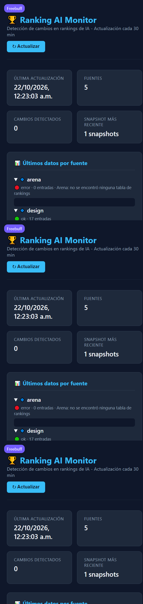

# 🏆 Ranking AI Agent

Bot de Telegram que te informa en lenguaje natural del **top y las novedades de modelos de IA**, con alertas de cambios en los rankings cada 30 minutos, **briefing diario de tendencias de GitHub y Hacker News** (`/hoy`), y un dashboard web con la evolución histórica de los ELOs.

## Qué hace

- **Scraping estructurado** de LMSYS/Arena, OpenRouter y Design Arena → datos normalizados (`rank`, `modelo`, `score`, `votes`), no texto crudo.
- **Detección de cambios determinista** (diff local): cambio de top-1, subidas/caídas de ≥3 posiciones, modelos nuevos y estrellas en ascenso en GitHub. Gemini solo redacta el boletín cuando hay cambios reales.
- **Safety net**: cada fuente se valida antes de guardar; si un scraper falla, se conservan los datos anteriores de esa fuente y se lanza alerta de error. Nunca se sobrescribe buenos datos con strings de error.
- **Multiusuario**: cualquier persona puede suscribirse con `/subscribe` y recibe las alertas; rate limit por usuario y presupuesto global diario de Gemini.
- **Briefing diario `/hoy`**: movimientos de rankings + top repos nuevos de IA en GitHub + historias calientes de Hacker News.
- **Dashboard web** (`/dashboard`): gráficas de evolución de ELO por modelo, últimos datos por fuente y cambios detectados.

## Captura del dashboard



## Arquitectura

```
src/
├── main.py       # Bot Telegram: handlers, jobs periódicos, rate limiting
├── fetcher.py    # Captura: OpenRouter (API con fallback Playwright), Arena/Design (Playwright, navegador único)
├── parsers.py    # Texto/JSON crudo → esquema normalizado {rank, model, score, votes}
├── validator.py  # Safety net: valida cada fuente antes de persistir
├── detector.py   # Diff local determinista entre snapshots + plantilla de alerta
├── trending.py   # GitHub Search API + Hacker News Algolia API (sin scraping)
├── brain.py      # Gemini (google-genai): redacción de boletines y respuestas al chat
├── updater.py    # Orquesta fetch → validate → persist → detect → notify
├── db.py         # SQLite: snapshots, cambios, suscriptores, historial de estrellas
├── web.py        # Dashboard Flask + API REST
└── keepalive.py  # Auto-ping para planes de hosting con sleep (Render free)
```

**Flujo de datos:** `fetcher` produce fuentes estructuradas → `validator` aprueba/rechaza cada una → `updater` persiste el snapshot (SQLite + `data/rankings.json`) → `detector` compara con el snapshot anterior → si hay cambios, `brain` redacta el boletín (con plantilla de fallback) y se envía a todos los suscriptores.

## Setup local

```bash
# 1. Dependencias
pip install -r requirements-dev.txt
playwright install chromium

# 2. Configuración
cp .env.example .env   # y rellena TELEGRAM_TOKEN, GEMINI_API_KEY, CHAT_ID

# 3. Tests y lint
python -m ruff check .
python -m pytest

# 4. Arrancar el bot
python -m src.main
```

## Comandos del bot

| Comando | Descripción |
|---------|-------------|
| `/start` | Bienvenida y registro como suscriptor |
| `/subscribe` | Recibir alertas de cambios y el briefing diario |
| `/unsubscribe` | Baja de las alertas |
| `/status` | Estado del sistema (datos, Gemini, uptime) |
| `/forceupdate` | Forzar actualización manual de rankings |
| `/hoy` | Briefing de hoy: rankings + tendencias de GitHub y HN |
| *(cualquier texto)* | Pregunta en lenguaje natural sobre el estado del arte |

## Variables de entorno

Ver [.env.example](.env.example). Las obligatorias son `TELEGRAM_TOKEN`, `GEMINI_API_KEY` y `CHAT_ID`. Opcionales: `GITHUB_TOKEN` (rate limit de la API de GitHub), `DATA_JSON_URL`, `DAILY_BRIEF_HOUR`, `GEMINI_DAILY_LIMIT`, `USER_RATE_LIMIT`.

## Despliegue

- **Render**: `Procfile` incluido (`web: python -m src.main`). El self-ping de `/health` mantiene despierto el plan gratuito.
- **GitHub Actions**: `.github/workflows/daily_scrape.yml` ejecuta un respaldo cada 12 h y guarda los datos en la rama `data` (sin force-push). El dashboard y el bot leen esos datos como respaldo remoto.
- **CI**: `.github/workflows/ci.yml` ejecuta ruff + pytest en cada push.

## Limitaciones conocidas

- El historial SQLite vive en `data/` (efímero en Render free); los datos estructurados se respaldan en la rama `data` del repo.
- La API de OpenRouter puede bloquearse desde ciertas IPs (WAF); el fetcher cae automáticamente al scraping con Playwright y parseo estructurado.
- GitHub no publica API para github.com/trending, así que las tendencias se calculan con la Search API oficial: repos **creados en las últimas 24 h** ordenados por estrellas (sección IA con `topic:ai` + sección general). No reproduce el algoritmo de "trending today" (que mezcla repos de cualquier antigüedad por velocidad de estrellas), pero es determinista, gratuito y sin scraping.
- Diseñado para un despliegue único; para escalar a muchas instancias conviene migrar SQLite a Postgres.

## Licencia

[MIT](LICENSE)
